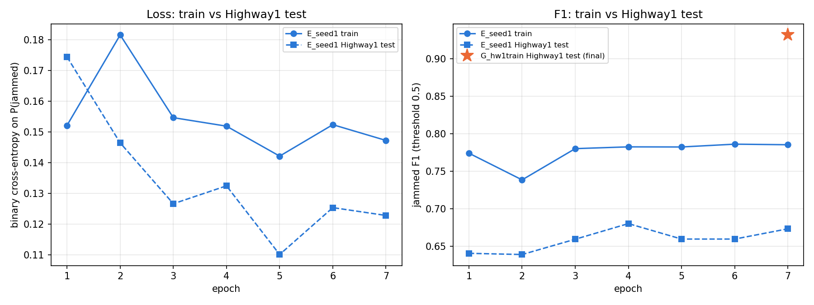

# Cross-site ViT: train on Highway2, test on Highway1

`HighwayViTModel` (ViT-B/16) is trained on Highway2 (9 classes) and evaluated as binary
jammed / not-jammed on the Highway1 subset. Runs A-F never see Highway1 during training (zero-shot);
run G also trains on Highway1's labelled `train.txt` split and is tested on its held-out `test.txt`.

## Reproduce

```bash
# 1. resize both datasets to 224x224 fp16 once (~45 s, ~3.3 GB)
python experiments/build_cache.py /path/to/cache fiot_highway2_f32 fiot_highway1_subset

# 2. train the best configuration (run E, ~20 min on an RTX 3060 laptop GPU)
python experiments/cross_site_vit.py --cache /path/to/cache --out runs --name E_synth2_spur \
    --pretrained --epochs 7 --augment time,freq,flip,synth \
    --synth-min-db 12 --synth-relative-row --spur-p 0.3

# 3. run G: the same recipe plus Highway1 train.txt (jammed samples drawn 8x more often), ~37 min
python experiments/cross_site_vit.py --cache /path/to/cache --out runs --name G_hw1train \
    --pretrained --epochs 7 --augment time,freq,flip,synth \
    --synth-min-db 12 --synth-relative-row --spur-p 0.3 --hw1-train

# 4. train vs Highway1 test curves per epoch
python experiments/plot_curves.py runs/E_seed1.json runs/G_hw1train.json -o train_test_curves.png
```

## Library equivalents

The same recipe is built into the package, so it can be trained with Lightning as well
(`examples/train_vit_cross_site.py`):

- `HighwayViTModel()` defaults now match run E: ImageNet weights, per-sample normalisation with a
  [-10, 50] dB window, layer-wise lr decay (backbone 1e-4, decay 0.75, head 1e-3) with warmup + cosine.
- `HighwayDataModule(use_cross_site_augmentation=True)` adds `RandomTimeRoll`, `RandomFreqShift`,
  `RandomFreqFlip`, `SyntheticJammer` (relabelled to class 4) and `BenignSpurs` from `radiomana.transforms`.
- `HighwayDataModule(highway1_train_root="DSET_FIOT_HIGHWAY1_SUBSET")` is run G: it appends Highway1
  `train.txt` with labels mapped to jammed (class 4) / clean (class 0) and oversamples its jammed samples
  (`highway1_jam_weight=8`). `python examples/train_vit_cross_site.py --with-highway1-train` trains it.

`cross_site_vit.py` is the GPU-batched version on the 224x224 cache that produced the reported numbers.

## Using the saved model

Weights are stored with Git LFS: run `git lfs install` before cloning, or `git lfs pull` after.

- `models/vit_hw2_hw1train.pt`: run G, the default for `predict_jamming` (Highway1 test F1 0.93).
- `models/vit_hw2_to_hw1.pt`: run E, zero-shot (never saw Highway1). Use it with
  `predict_jamming(x, model=load_jamming_detector("models/vit_hw2_to_hw1.pt"))`.

Each has a `*_metrics.json` with its config and metrics.

```python
from radiomana import predict_jamming

result = predict_jamming("fiot_highway1_subset/data/40504.npy")  # a path, list of paths, or (N, 512, 243) array
result.jammed           # bool per sample
result.p_jammed         # probability of interference per sample
result.predicted_label  # most likely Highway2 class name
```

`predict_jamming(..., threshold=0.9)` trades recall for fewer false alarms. `load_jamming_detector(path)`
loads other weights, and from the shell: `python -m radiomana.inference file1.npy file2.npy`.

## Results

All of Highway1 (16,384 samples, 253 jammed), threshold 0.5 on P(jammed). Accuracy alone is
misleading here: predicting "not jammed" for everything scores 98.5%.

| Run | Change | Acc | Bal. acc | Precision | Recall | F1 | AUROC | False alarms |
|---|---|---|---|---|---|---|---|---|
| A | original setup: random init, absolute dB window | 23.7% | 0.42 | 0.01 | 0.60 | 0.02 | 0.39 | 12,396 |
| B | ImageNet init + per-sample (median-relative) dB | 99.0% | 0.71 | 0.85 | 0.42 | 0.57 | 0.82 | 19 |
| C | B + time/freq shift, flip augmentation | 99.1% | 0.70 | 0.99 | 0.39 | 0.56 | 0.86 | 1 |
| D | C + synthetic tone/pulse/noise jammers | 95.3% | 0.87 | 0.22 | 0.78 | 0.34 | 0.89 | 713 |
| **E** | **C + stronger synthetic jammers + benign-spur negatives** | **99.2%** | **0.84** | **0.74** | **0.69** | **0.72** | 0.87 | 60 |
| F | E with patch embed + first 4 blocks frozen | 99.1% | 0.84 | 0.72 | 0.68 | 0.70 | 0.83 | 67 |

Run E on the Highway1 `test.txt` split alone (3,473 samples, 51 jammed): 99.1% acc, 0.83 balanced acc, F1 0.69.
On Highway2's own test split it gets 70.6% 9-class accuracy.

### Adding labelled Highway1 data (run G)

Highway1 `test.txt` only (3,473 samples, 51 jammed), threshold 0.5. Run G trains on Highway1 `train.txt`
(12,911 samples, 202 jammed), so these numbers are not zero-shot and are not comparable with the table above.

| Run | Training data | Acc | Bal. acc | Precision | Recall | F1 | AUROC | Jammed caught | False alarms |
|---|---|---|---|---|---|---|---|---|---|
| E | Highway2 only | 99.1% | 0.83 | 0.71 | 0.67 | 0.69 | 0.84 | 34 / 51 | 14 |
| E, seed 1 | Highway2 only | 99.1% | 0.82 | 0.70 | 0.65 | 0.67 | 0.82 | 33 / 51 | 14 |
| **G** | **Highway2 + Highway1 train.txt** | **99.8%** | **0.97** | **0.92** | **0.94** | **0.93** | **0.96** | **48 / 51** | **4** |

Per class on the test split, G catches pulsed jammers (classes 3, 4) 7/7 vs 0/7 for E, out-of-band tones (5)
15/17 vs 10/17 and in-band tones (7) 11/11 vs 9/11; it misses the single noise jammer (6) and two
out-of-band tones. Highway2 test accuracy is unchanged (70.7%). The E repeat with another seed shows the
E vs G gap is far larger than seed-to-seed variation; G was run with one seed.

This takes the idea from `tests/data_loading_binaryclass.ipynb` (train on Highway2 plus a slice of
Highway1), but uses the official `train.txt` / `test.txt` split instead of 15% of `test.txt`, which gives
~25x more real jammers to learn from and an untouched test set.



Train vs Highway1 test per epoch for the E repeat (G was trained before per-epoch curves were logged, so
only its final test F1 is shown). The train loss sits above the test loss because ~8% of training samples
are jammed vs 1.5% of Highway1 test samples, so it reflects the base rate rather than overfitting.

What mattered:
- **Per-sample normalisation** is essential: Highway1 sits at a different absolute power level, so the
  fixed dB window made the original model call every high-intensity Highway1 background "jammed".
- **ImageNet weights** beat random init by a wide margin at this data size.
- **Synthetic jammers** (run D): Highway2 only contains chirps and cigarette-lighter jammers, so B/C detect
  Highway1 chirps perfectly but miss tones entirely. Painting tones/pulses/noise bands onto clean Highway2
  samples raised tone recall from ~0% to 61-85%.
- **Benign spurs** (run E): Highway1 backgrounds contain faint constant narrowband spurs that D mistook for
  tones. Adding faint lines to clean samples while keeping the "clean" label cut false alarms ~12x.
- Freezing early blocks (F) trains ~15% faster but is slightly worse; an E+F ensemble did not help.

Per-class recall for run E: chirps (8, 9, 10) 100%, in-band tone (7) 85%, out-of-band tone (5) 61%,
pulsed (3, 4) and noise (6) 0%. Pulsed jammers resemble the broadband transients present in clean
Highway2 backgrounds, so they remain the main gap.

Caveat: runs D→E were adjusted after looking at Highway1 false alarms, so Highway1 is not a fully
untouched test set for E. Highway1 was never used for training or gradient updates.

Note: `fiot_highway1_subset/README.md`'s class-count table does not match `train.txt`/`test.txt`; the
actual split has 202 jammed samples in train and 51 in test.
