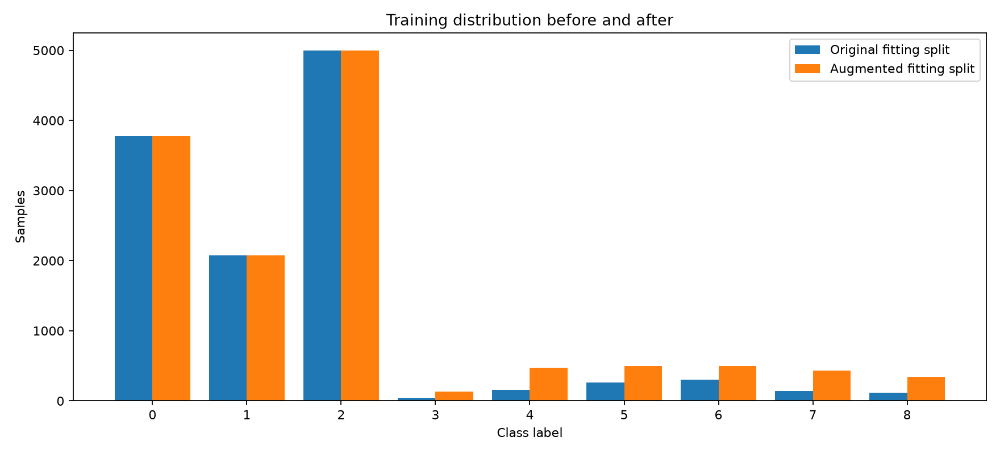

# Highway2 Task 1 execution report

Completed locally on 2026-11-12. Generated **1,359** labeled synthetic spectrograms; fitting samples increased from **11,865 to 13,224**. Original data remained unchanged. Implementation and commands: [TASK1_README.md](../../TASK1_README.md).

## Data and repository inspection

Inspected the supplied repository at commit `c74c9117e5c917b2ed97306a760a953bae36f245`: dataset and Lightning loaders, transforms, spectral statistics, visualization, SqueezeNet baseline and ViT preprocessing/models, inference, training examples, cross-site experiments/cache building, dataset notebooks and tests. The local upstream checkout was also examined, but changes are isolated to the delivered clone of the requested repository.

The dataset was found at `${HIGHWAY2_ROOT}`, with an additional ZIP in Downloads. All 16,480 indexed arrays were available and checked. Data are float32 512-frequency × 243-time log-power arrays; acquisition documentation describes 20 ms IQ snapshots at 62.5 MHz, but the distributed arrays are spectrograms, not raw IQ. Observed corpus extrema were −135.694 to 0 dB. The loader's approximate −90 dB noise-floor comment was not used to calibrate augmentation.

The supplied training index has 13,184 samples. Reusing the repository's stratified split and seed yields 11,865 fitting samples and 1,319 validation samples. The supplied 3,296-sample test set is unchanged.

## Counts and selection

The cutoff is 500: `ceil(10% × 4,997)`. This follows the repository's existing 10%-of-majority balancing rationale, but applies correctly to all nine classes, including rare background class 3. A two-variant-per-parent cap limits correlated oversampling. This is a practical training-budget heuristic, not a statistically optimal threshold; it was fixed before baseline evaluation.

| Label | Class | Supplied train.txt | Fitting originals | Generated | Augmented fitting |
|---|---|---:|---:|---:|---:|
| 0 | Background a | 4,192 | 3,773 | 0 | 3,773 |
| 1 | Background b | 2,304 | 2,074 | 0 | 2,074 |
| 2 | Background c | 5,552 | 4,997 | 0 | 4,997 |
| 3 | Background d | 48 | 43 | 86 | 129 |
| 4 | Chirp, high distance | 176 | 158 | 316 | 474 |
| 5 | Chirp, medium distance | 288 | 259 | 241 | 500 |
| 6 | Chirp, small distance | 336 | 302 | 198 | 500 |
| 7 | Cigarette lighter 1 | 160 | 144 | 288 | 432 |
| 8 | Cigarette lighter 2 | 128 | 115 | 230 | 345 |
| **Total** | | **13,184** | **11,865** | **1,359** | **13,224** |

## Methodology and leakage controls

Small receiver gain (±0.25 dB) plus positive gamma noise power preserves the frequency/time grid and labels. Noise is calibrated from each fitting source only, at 14–20 dB below its first percentile. Log-add-exp performs stable addition of powers. Gamma shape 16 approximates averaged noise periodograms; acquisition averaging metadata is unavailable. The existing signed-Gaussian-on-power transform can create negative powers and clipping artifacts, so it was not reused. Existing cross-site flips and jammer relabeling are unsuitable for this nine-class task. Time shifts/crops were excluded to avoid wrap seams or changed dimensions.

Seed 20261112 controls balanced parent selection and per-sample seeds. Each saved file has provenance, parameters and a hash. All parents were verified to belong to the original fitting split, with matching labels. Validation and test manifests match the original loader exactly. The new datamodule avoids re-splitting synthetic data.

Every original array was checked for shape, floating dtype, finite values and exact content duplication. There were **zero exact duplicate groups**, within or across splits. Original array hashes and train/test manifest hashes were verified again after generation. Numeric filenames and labels provide no recording/session IDs or timestamps, so **session-level leakage remains unverified**. Related nonidentical snapshots can cross splits even when hashes differ; these results are not a certificate of independent recording sessions.

## Validation findings

- All **18 automated tests passed**, including the existing tests; one existing MPS pin-memory warning was non-fatal. New-file lint checks passed.
- All **1,359** synthetic files were read through the unmodified `Highway2Dataset` loader, validated as float32 `[512,243]`, and reproduced bit-for-bit from recorded seeds.
- Parent labels/membership and the two-variant cap passed. A batch loaded as `[32,512,243]`.
- Correlations ranged **0.999652–0.999996**; RMSE ranged **0.0594–0.3059 dB**; total power changes ranged **−0.2498 to +0.2500 dB**.
- RadioManA spectral statistics showed maximum centroid change **620.51 Hz**, spread change **786.23 Hz**, and **zero peak-frequency-bin changes**. Those frequency values use the repository's bin-frequency convention.
- Six comparison plots were generated, with shared color scales. The chirp comparison was visually inspected: its sweep structure remained visible and the plot had readable labels. Automated checks cover every synthetic array; human/domain-expert review of every class is not claimed.

Very low-power individual bins may rise by several dB after positive noise addition; small global RMSE and unchanged spectral peaks confirm that these changes did not dominate the observed spectra. The quality gates are engineering plausibility checks, not proof of physical equivalence or correct labels under every possible receiver model.

## Baseline experiment actually run

A CPU logistic-regression classifier used 125 fixed frequency/time block statistics and dB quantiles. Each arm fitted its scaler only on its training data; both used C=1, maximum 1,000 iterations, seed 20261112 and the same frozen validation/test samples. Both converged before the iteration limit (411 and 449 iterations). No test-set tuning or pretrained weights were used.

| Untouched test metric | Original training | Augmented training |
|---|---:|---:|
| Accuracy | 77.82% | 77.37% |
| Balanced accuracy | 60.78% | 65.11% |
| Macro-F1 | 0.6303 | 0.6484 |

Validation macro-F1 was 0.6414 versus 0.6759. Full per-class metrics and confusion matrices are in `baseline_metrics.json`. The result suggests improved rare-class coverage at a slight overall-accuracy cost. It is one run, without confidence intervals or a duplication-only control; therefore it does not establish a statistically significant augmentation benefit. A full SqueezeNet/ViT comparison was not run. No Task 2 CNN was implemented.

## Deliverables and remaining limits

All eight requested deliverable types are present: implementation, original CSV/chart, synthetic `.npy` samples, augmented CSV/chart, comparison plots, runnable commands, README, and this report. See `summary.json`, `audit.json`, `original_integrity.csv`, `provenance.csv`, `loader_validation.json`, and the execution logs in the parent output directory for evidence.

The samples are mild, correlated variants rather than independent new captures; imbalance remains intentionally. Session-disjoint evaluation requires acquisition metadata not included in this local release. Stronger augmentation, physical label validation, multiple training seeds, and a full neural-model ablation remain future work. Synthetic derivatives retain the source dataset's CC BY-NC-SA 4.0 attribution/license, as documented in the README.

## Final neural training integration verification

The final integration check **passed** using the repository's existing `HighwayBaselineModel` / **SqueezeNet 1.1**, unmodified cross-entropy training/validation steps and AdamW (learning rate 0.001, weight decay 0.05). `Lightning Trainer.fit` executed on CPU, float32, two threads, seed 20261112. No production pipeline changes or synthetic regeneration were needed.

A full read/hash audit confirmed **11,865 original + 1,359 synthetic = 13,224 fitting samples**, with the per-class counts above. Every stored array has native float32 `[512,243]` shape and finite values. Original labels match the supplied manifests; synthetic labels match provenance and fitting parents. The existing shuffled DataLoader successfully produced a batch. Validation (**1,319**) and test (**3,296**) manifests match the repository split exactly and contain no synthetic samples. All 17,848 audited array/manifest files had identical before/after byte hashes, and array content hashes matched the saved generation audit.

A targeted training sampler selected 15 distinct samples while retaining the complete training dataset. Model forward hooks recorded **nine originals, covering classes 0–8, and six synthetics, covering classes 3–8**. All five batches contained original and synthetic data. The hooks identify actual model inputs by tensor content, rather than assuming sampler selection proves consumption.

| Training batch | Loss | Gradient L2 norm | Maximum absolute parameter update |
|---|---:|---:|---:|
| 1 | 5.313212 | 436.0517 | 0.00103056 |
| 2 | 2.322757 | 52.4366 | 0.00102836 |
| 3 | 2.373376 | 19.4409 | 0.00102004 |
| 4 | 2.289867 | 7.0443 | 0.00100781 |
| 5 | 2.231174 | 3.3325 | 0.00100436 |

All logits, losses, gradients and updated parameters were finite. Five optimizer updates completed without shape, dtype, label or device errors. One validation batch of three original samples passed, with loss **2.1972413**. These few batches verify wiring and execution only; their losses are not a model-performance claim.

The relevant existing suite was rerun: **18 passed**, with one non-fatal existing MPS pin-memory warning. Smoke-test warnings were informational (CPU selected despite available MPS, small worker count and a dependency deprecation). No integration bug was found or production-code fix required. Only a reproducible smoke-test script and documentation/evidence were added for this verification.

Evidence: [neural_integration.json](results/neural_integration.json), [execution log](evidence/neural_integration.txt), [test log](evidence/final_integration_tests.txt), and [script](../../examples/task1_neural_smoke.py). Reproduction commands are in the [Task 1 README](../../TASK1_README.md).

**Task 1 is ready to present to the TA and Aerospace Corporation team as an implemented, validated synthetic-data pipeline with verified neural-training integration.** Remaining limits are session-level independence (metadata unavailable), correlated synthetic variants, CPU-only smoke coverage, and no full neural-training comparison. These do not invalidate the integration result. Task 2 was not started.

## Collaboration package

Results in `results/` are a historical evidence snapshot, not runnable dataset manifests. Machine-specific paths were replaced by `${HIGHWAY2_ROOT}`, `${TASK1_OUTPUT}`, `${REPOSITORY}` and `${PYTHON_ENV}`. Numeric measurements and sample identities were preserved. Logs are in `evidence/`. The source dataset, synthetic arrays and runtime manifests are excluded from Git. See [DATA_LICENSE.md](DATA_LICENSE.md) before redistributing derivatives and the root [Task 1 README](../../TASK1_README.md) for portable execution.

### Packaging validation

The complete relevant suite passed **20 tests**: the original 18 plus CLI generation/relocation integration and mismatched-source rejection. The CLI test uses temporary fixtures, moves the originals to a different path, and verifies unchanged synthetic hashes, frozen membership, batching and exhaustive validation after relocation. The real dataset was not regenerated. Editable-install metadata was checked with `pip install --dry-run --no-deps --no-build-isolation -e .`; dependency installation into a fresh environment was not performed. All documented CLI parsers and new-file lint checks passed. See `evidence/packaging_tests.txt` and `evidence/editable_install_check.txt`.
